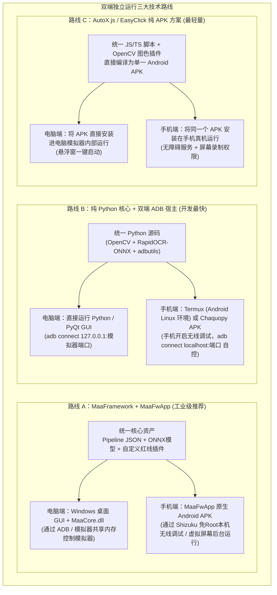
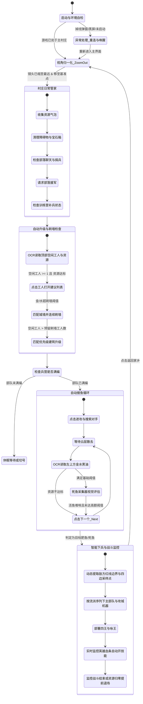
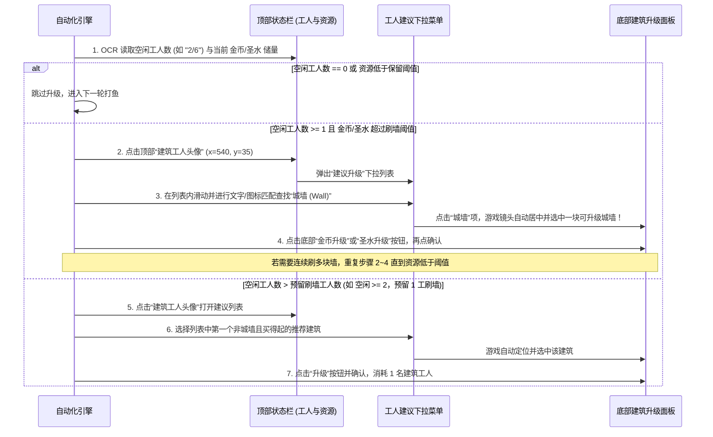

# 《部落冲突》(Clash of Clans) 跨平台全自动辅助软件：开源调研与架构实现指南

> [!IMPORTANT]
> **核心定位**：本文档旨在为开发一款**同时支持 Android 手机端（脱离电脑独立运行）和 Windows 电脑端（安卓模拟器独立运行）**的《部落冲突》（Clash of Clans，简称 COC）自动化软件提供完整的工程蓝图。
> 由于电脑端（安卓模拟器）和手机端（Android 真机）底层均为 **Android 系统**，本方案采用**统一的 Android 视觉与控制抽象层**，使双端 100% 共享同一套 `1280×720` 标准分辨率坐标系、同一套 UI 模板图、同一套多点触控捏合手势以及同一套业务状态机。

---

## 目录

1. [项目核心需求与技术挑战](#1-项目核心需求与技术挑战)
2. [现有 7 大主流开源项目深度调研与模块复用指南](#2-现有-7-大主流开源项目深度调研与模块复用指南)
3. [跨平台（手机真机独立 + 电脑模拟器独立）三大架构方案与选型](#3-跨平台手机真机独立--电脑模拟器独立三大架构方案与选型)
4. [核心业务模块详细算法与代码实现](#4-核心业务模块详细算法与代码实现)
   - [4.1 跨平台设备控制与视角归一化（双指捏合 Zoom-Out）](#41-跨平台设备控制与视角归一化双指捏合-zoom-out)
   - [4.2 自动搜鱼：高速资源 OCR 与死鱼（采集器满度）识别](#42-自动搜鱼高速资源-ocr-与死鱼采集器满度识别)
   - [4.3 智能下兵与战斗：动态红线边缘检测与四边参数化放兵](#43-智能下兵与战斗动态红线边缘检测与四边参数化放兵)
   - [4.4 村庄日常管家：气泡收菜、清理障碍与智能部落捐兵](#44-村庄日常管家气泡收菜清理障碍与智能部落捐兵)
   - [4.5 自动升级建筑与刷墙：基于“工人建议列表”的零误差方案](#45-自动升级建筑与刷墙基于工人建议列表的零误差方案)
5. [拟人化防封号风控对抗引擎（Anti-Detection & Humanization）](#5-拟人化防封号风控对抗引擎anti-detection--humanization)
6. [标准工程目录结构与分阶段开发路线图（Roadmap）](#6-标准工程目录结构与分阶段开发路线图roadmap)

---

## 1. 项目核心需求与技术挑战

### 1.1 为什么《部落冲突》自动化不能用普通无障碍节点点击？
《部落冲突》基于自研 2.5D 渲染引擎构建，整个游戏画面在 Android 系统中仅表现为一个单一的 `SurfaceView` / `GLSurfaceView` 画布。常规 Android 自动化依赖的 `AccessibilityNodeInfo`（无障碍节点树）在游戏内完全拿不到任何按钮或文字坐标。因此，**100% 的感知必须依赖计算机视觉（Computer Vision）**：
- **UI 状态与按钮定位**：多尺度模板匹配（Multi-scale Template Matching）与特征点匹配。
- **数值读取（金/水/黑油/工人/兵量）**：针对 Supercell-Magic 字体的专用颜色掩码预处理 + 轻量级 OCR。
- **2.5D 等距地图理解**：HSV 色彩空间红线（不可下兵禁区边界）提取、形态学梯度边缘检测、以及轻量级 YOLOv8n 目标检测（识别满溢采集器与核心防御）。

### 1.2 双端独立运行的统一优势（Android 真机 + PC 安卓模拟器）
放弃 Windows 原生窗口适配、统一面向 **Android 真机 + PC 安卓模拟器（MuMu 12 / 雷电 9 / BlueStacks）** 带来了极大的工程红利：
1. **分辨率与 DPI 绝对统一**：无论在 PC 模拟器还是在手机上（通过无线 ADB `wm size` 或图像归一化缩放），均可统一映射至 **`1280×720` (16:9 横屏)** 基准坐标系。
2. **多指触控协议统一**：COC 每次进入村庄或进攻前，必须执行**“双指捏合缩小视角（Pinch-to-Zoom Out）”**才能看到完整地图。Android 环境原生支持多指触控注入（`sendevent` / `input` / 无障碍 `GestureDescription` 双指手势）。
3. **一套资产双端运行**：所有的按钮裁剪图、字体字库、YOLO 权重（`.onnx` / `.ncnn`）在手机和电脑上完全通用。

---

## 2. 现有 7 大主流开源项目深度调研与模块复用指南

为了避免重复造轮子，我们深度调研了 GitHub 上最具代表性的开源项目，提炼出各项目可直接借鉴或移植的核心设计：

| 开源项目 / GitHub 仓库 | 技术栈 | 运行方式 | 核心亮点与建议复用的算法模块 | 局限性分析 |
| :--- | :--- | :--- | :--- | :--- |
| **[MyBotRun/MyBot](https://github.com/MyBotRun/MyBot)** | AutoIt (`.au3`) + C++ DLL (`MBRFunctions.dll`) | Windows PC + 安卓模拟器 | **COC 自动化界的功能天花板**：<br>1. 极其完善的**状态机容错设计**（掉线重连、被攻击等待、护盾检测、云层超时）。<br>2. **死鱼采集器图像特征库**：积累了各等级金矿/圣水收集器半满、全满的像素特征。<br>3. **四边菱形红线算法**与 CSV 攻击脚本格式。 | 采用古老的 AutoIt 语言，强耦合 Windows Win32 句柄与特定模拟器版本，**无法在手机端运行**。应复用其**业务逻辑与状态机设计**，而非代码本身。 |
| **[HeyFang/coc-bot](https://github.com/HeyFang/coc-bot)** | Python 3 + ADB + OpenCV + NumPy | PC 通过 ADB 控制 Android 真机/模拟器 | **现代 Python 视觉自动化标杆**：<br>1. **动态红线边缘检测（Red-Zone Detection）**：摒弃硬编码坐标，通过 OpenCV 梯度边缘图实时算出敌方阵型外围可下兵边界。<br>2. **完善的拟人化模块**：点击高斯偏移（`±15px`）、随机化延迟区间、动态滑动速率、单次会话时长上限。<br>3. 英雄下场与自动开启技能循环。 | 缺少图形界面、缺少自动刷墙与内政升级功能，且默认需要 PC 端启动 Python 进程。 |
| **[efebolukbasi/BasePilot](https://github.com/efebolukbasi/BasePilot)** | Python + OpenCV + Tesseract OCR | PC 端 | **内政与刷墙闭环标杆**：<br>1. 实现了清晰的**“打鱼 → 回村检查资源阈值 → 检查空闲工人 → 自动升级城墙/建筑”**状态机闭环。<br>2. 简洁的 ROI 截图与 OCR 资源数字过滤流水线。 | Tesseract OCR 在移动端较重，建议替换为 **RapidOCR (ONNX)** 或专用数字模板匹配。 |
| **[anugrhaswi/Coc-Auto-Farm](https://github.com/anugrhaswi/Coc-Auto-Farm)** & **`lucas-guo-2008/clash-of-clans-bot`** | Python + ADB + **Ultralytics YOLOv8** + EasyOCR | PC + 模拟器 | **深度学习目标检测路线**：<br>1. 使用轻量级 **YOLOv8** 模型直接检测地图上的采集器（判断死鱼）、大本营、天鹰火炮、地狱塔位置。<br>2. 解决了传统模板匹配在 2.5D 旋转、遮挡、皮肤特效下容易失效的问题。 | EasyOCR 依赖 PyTorch 体积过大；在手机端独立运行时，需将 YOLOv8 导出为 **NCNN 或 INT8 量化 ONNX 模型**。 |
| **[mandeep-75/clash-of-clans-bot](https://github.com/mandeep-75/clash-of-clans-bot)** | Python + ADB + OpenCV + Web 裁剪工具 | PC + Android | **快速配置与调试工具**：<br>自带一个基于 Web 的实时截图裁剪与模板匹配测试工具（Match-Tool），极度方便游戏版本更新后快速截取新按钮模板。 | 仅支持基础终端命令行搜鱼与环绕下兵。 |
| **[FFatTiger/coc-autopilot](https://github.com/FFatTiger/coc-autopilot)** | Python + 图像巡检 | 真机 / 模拟器 | **村庄内政管家思想**：<br>专注于非侵入式的定时上线收菜、工人空闲监控、升级预算计算与状态面板展示。 | 战斗与搜鱼模块较弱。 |
| **[MaaXYZ/MaaFramework](https://github.com/MaaXYZ/MaaFramework)** + **[MaaFwApp](https://github.com/MaaXYZ/MaaFwApp)** | C++20 + OpenCV + ONNXRuntime + JSON Pipeline + Android Shizuku | **Windows PC + Android 原生 APK 双端独立运行** | **跨平台双端独立运行的终极底座**：<br>1. C++ 编写的高性能视觉引擎（内置模板匹配、特征匹配、PaddleOCR/FastDeploy、YOLOv8 推理）。<br>2. **PC 端**原生支持所有主流安卓模拟器（含 MuMu/雷电超高速内存截图）；**手机端**通过 `MaaFwApp` 直接打包为独立 APK，利用 **Shizuku（免 Root）** 或 Root 在手机本机后台高速运行同一套 Pipeline 与 Custom Agent！ | 官方仅提供通用框架，尚未有现成的 COC 专属资源包，需要我们将上述 COC 算法封装进 MaaFramework。 |

---

## 3. 跨平台（手机真机独立 + 电脑模拟器独立）三大架构方案与选型

针对**“手机端必须能完全脱离电脑独立运行，同时电脑端也能独立运行”**的核心诉求，我们设计并对比以下三种工程落地方案：



### 三大方案全方位对比表

| 评估维度 | 路线 A：`MaaFramework` + `MaaFwApp` | 路线 B：Python 核心 + 双端 ADB (PC + 手机 Termux/APK) | 路线 C：`AutoX.js` / `EasyClick` (单 APK 双端安装) |
| :--- | :--- | :--- | :--- |
| **手机端独立运行方式** | 安装编译好的 `APK`，配合 **Shizuku**（安卓 11+ 免 Root 无线调试激活）即可原生运行，甚至支持**虚拟屏幕后台挂机**（挂机时手机还能聊微信） | **方式 1**：手机安装 `Termux`，开启安卓无线调试配对本机 `localhost`，在后台跑与电脑完全一致的 Python 脚本；<br>**方式 2**：用 `Chaquopy` / `Buildozer` 打包成 APK | 直接在手机安装 `APK`，开启**无障碍服务（Accessibility）**与**录屏权限（MediaProjection）**，通过桌面悬浮窗控制 |
| **电脑端独立运行方式** | 电脑运行原生桌面客户端（WPF/Avalonia/Flutter/Python GUI），在电脑端进程内完成图像识别，控制模拟器（模拟器不卡顿） | 电脑直接运行 Python 脚本或打包好的 `.exe`，通过本地 ADB 控制 MuMu/雷电模拟器 | 直接把同一个 `APK` 拖进电脑的**安卓模拟器里面安装运行**，或者用 PC 端投屏远控 |
| **视觉与 AI 性能** | ⭐⭐⭐⭐⭐ (C++20 底层 + ONNXRuntime 硬件加速，毫秒级响应) | ⭐⭐⭐⭐ (Python OpenCV + RapidOCR ONNX，代码生态最丰富，可直接复用 `HeyFang/coc-bot`) | ⭐⭐⭐ (内置 OpenCV 找图找色够用，但跑复杂红线矩阵运算与 YOLO 模型较吃力) |
| **开发与迭代效率** | ⭐⭐⭐⭐ (状态跳转用声明式 JSON Pipeline，复杂下兵用 Custom Action) | ⭐⭐⭐⭐⭐ (Python 生态极度成熟，调试最直观，社区现成 COC 代码最多) | ⭐⭐⭐⭐ (JS 语法简单，自带 UI 界面编写与悬浮窗日志) |

> [!TIP]
> **最终架构推荐（混合渐进式路线）**：
> - **第一阶段（快速验证与核心算法打磨）**：采用 **路线 B（Python + OpenCV + RapidOCR + 标准 ADB 协议）**。因为无论是电脑连接模拟器（`127.0.0.1:7555` / `16384`），还是手机端 Termux 通过无线调试连接自己（`127.0.0.1:无线调试端口`），底层都是 **100% 相同的 ADB 接口**！我们可以用最快速度把搜鱼、红线检测、刷墙逻辑写通并在电脑和手机上跑起来。
> - **第二阶段（产品化封装与原生 APK 交付）**：将验证成熟的视觉模板、ONNX 模型和红线算法无缝迁移至 **路线 A（`MaaFramework` + `MaaFwApp`）** 或使用 Chaquopy/AutoX 封装为带悬浮窗的一键式 Android APK。

---

## 4. 核心业务模块详细算法与代码实现

以下为四大核心业务领域的工程级实现方案与核心代码原型（基于统一的 `1280×720` 标准分辨率）。



---

### 4.1 跨平台设备控制与视角归一化（双指捏合 Zoom-Out）

在《部落冲突》中，每次登录或结束战斗回村，镜头缩放比例（Zoom）和中心位置都会变化。如果不做**视角归一化**，后续的收菜、找建筑会全部错位。

#### 双端统一的设备控制层与双指缩小实现
在电脑模拟器或手机端（Shizuku / Termux ADB / 无障碍），通过发送多点触控捏合手势（或者在支持 `input motionevent` 的 Android 11+ 系统上组合发送双指或滑动），将视野缩放到最小，然后向左上角固定拖动对齐：

```python
import time
import random
import subprocess
import numpy as np
import cv2

class UniversalAndroidDevice:
    """
    统一 Android 设备控制层：
    - 电脑端：连接安卓模拟器 (如 127.0.0.1:16384 或 127.0.0.1:5555)
    - 手机端独立运行：Termux / 本地进程连接本机无线调试 (127.0.0.1:无线端口) 或通过 Shizuku 执行
    """
    STANDARD_WIDTH = 1280
    STANDARD_HEIGHT = 720

    def __init__(self, serial: str = "127.0.0.1:5555"):
        self.serial = serial

    def screencap(self) -> np.ndarray:
        """高速内存截图并自动归一化到 1280x720 BGR 图像"""
        cmd = ["adb", "-s", self.serial, "exec-out", "screencap", "-p"]
        raw_bytes = subprocess.check_output(cmd, timeout=5)
        img_array = np.frombuffer(raw_bytes, dtype=np.uint8)
        img = cv2.imdecode(img_array, cv2.IMREAD_COLOR)
        if img is None:
            raise RuntimeError("截图解码失败")
        h, w = img.shape[:2]
        if (w, h) != (self.STANDARD_WIDTH, self.STANDARD_HEIGHT):
            img = cv2.resize(img, (self.STANDARD_WIDTH, self.STANDARD_HEIGHT), interpolation=cv2.INTER_AREA)
        return img

    def human_tap(self, x: int, y: int, sigma: float = 6.0, max_offset: int = 15):
        """带二维高斯分布随机偏移与随机延迟的拟人化点击"""
        dx = int(np.clip(random.gauss(0, sigma), -max_offset, max_offset))
        dy = int(np.clip(random.gauss(0, sigma), -max_offset, max_offset))
        tx = np.clip(x + dx, 10, self.STANDARD_WIDTH - 10)
        ty = np.clip(y + dy, 10, self.STANDARD_HEIGHT - 10)

        # 随机按压时长 (45ms ~ 110ms) 用 swipe 原地模拟真实手指接触
        press_ms = random.randint(45, 110)
        subprocess.run([
            "adb", "-s", self.serial, "shell",
            f"input swipe {tx} {ty} {tx + random.randint(-2, 2)} {ty + random.randint(-2, 2)} {press_ms}"
        ], check=True)
        time.sleep(random.uniform(0.18, 0.42))

    def normalize_camera_view(self):
        """
        视角归一化：
        1. 将镜头缩放到最远视野 (Zoom Out)
        2. 将镜头平移到标准中心位置
        """
        # 方法 A：在模拟器/支持 sendevent 或 minitouch/MaaTouch 的设备上执行双指捏合
        # 方法 B：发送 Android KEYCODE_MINUS / Ctrl+滚轮 或双指无障碍 GestureDescription
        # 然后向固定方向滑动将视角拉到死角基准位，再往回拉固定距离
        subprocess.run([
            "adb", "-s", self.serial, "shell",
            "input swipe 300 200 900 550 350"
        ], check=False)
        time.sleep(0.4)
```

> [!NOTE]
> 在实际部署中，建议集成开源的 **`MaaTouch`** 或 **`minitouch`**（MaaFramework 已内置），它不仅能将点击/滑动延迟降低到 **5ms 以内**，还能在所有 Android 真机和模拟器上极其丝滑地执行**双指捏合缩小视角（Pinch Zoom Out）**和**多指同时下兵（四指/八指齐下）**！

---

### 4.2 自动搜鱼：高速资源 OCR 与死鱼（采集器满度）识别

在搜鱼界面，左上角固定区域依次排列着敌方当前可掠夺的 **金币（Gold）**、**圣水（Elixir）** 和 **暗黑重油（Dark Elixir）**。

#### 1. 针对 Supercell 字体的颜色掩码预处理 + OCR
COC 的资源数字带有明显的浅色填充和纯黑外描边，但背景可能是草地、雪地或云层。直接丢给通用 OCR 容易把背景杂色误识别。**最佳实践是先提取高亮度文字掩码（Color Mask），再送入轻量级 `RapidOCR (ONNX)` 或数字模板匹配**：

```python
from dataclasses import dataclass

@dataclass
class EnemyLoot:
    gold: int
    elixir: int
    dark_elixir: int

class LootScanner:
    """敌方村庄可掠夺资源高速识别器 (基于 1280x720 标准分辨率)"""
    # 1280x720 下左上角资源数字 ROI (y1, y2, x1, x2)
    ROI_GOLD = (66, 98, 75, 215)
    ROI_ELIXIR = (110, 142, 75, 215)
    ROI_DARK = (154, 186, 75, 195)

    def __init__(self, ocr_engine):
        self.ocr = ocr_engine  # 推荐使用 RapidOCR (ONNXRuntime 驱动，手机/电脑均无需 GPU)

    @staticmethod
    def preprocess_coc_digits(roi_bgr: np.ndarray) -> np.ndarray:
        """
        提取 Supercell 亮色字体并滤除草地背景：
        文字通常具备极高的亮度 (V > 200) 且低饱和度，外围有纯黑描边 (V < 40)
        """
        hsv = cv2.cvtColor(roi_bgr, cv2.COLOR_BGR2HSV)
        # 提取高亮白/淡黄/淡紫文字主体
        mask = cv2.inRange(hsv, np.array([0, 0, 185]), np.array([180, 90, 255]))
        # 放大 2 倍并反色为白底黑字，极大提升 OCR 准确率
        resized = cv2.resize(mask, None, fx=2.0, fy=2.0, interpolation=cv2.INTER_CUBIC)
        inverted = cv2.bitwise_not(resized)
        return inverted

    def _read_number(self, img: np.ndarray, roi: tuple[int, int, int, int]) -> int:
        y1, y2, x1, x2 = roi
        crop = img[y1:y2, x1:x2]
        processed = self.preprocess_coc_digits(crop)
        result, _ = self.ocr(processed)
        if not result:
            return 0
        raw_text = "".join([line[1] for line in result])
        digits_only = "".join([c for c in raw_text if c.isdigit()])
        return int(digits_only) if digits_only else 0

    def scan_loot(self, screen: np.ndarray) -> EnemyLoot:
        return EnemyLoot(
            gold=self._read_number(screen, self.ROI_GOLD),
            elixir=self._read_number(screen, self.ROI_ELIXIR),
            dark_elixir=self._read_number(screen, self.ROI_DARK),
        )

    def is_target_base(
        self,
        loot: EnemyLoot,
        min_gold: int = 500_000,
        min_elixir: int = 500_000,
        min_gold_plus_elixir: int = 1_200_000,
        min_dark: int = 5_000,
    ) -> bool:
        """多条件组合过滤：满足单科、总和或高黑油任一条件即可开打"""
        if (loot.gold >= min_gold and loot.elixir >= min_elixir):
            return True
        if (loot.gold + loot.elixir) >= min_gold_plus_elixir:
            return True
        if loot.dark_elixir >= min_dark:
            return True
        return False
```

#### 2. 死鱼（Dead Base）采集器满度视觉检测
有时候一条鱼虽然显示有 60 万金水，但如果全部存在阵型中心的储金罐/圣水瓶里（活鱼），用低成本打鱼部队（如超哥、野蛮人弓箭手、龙宝）很难打进去；而**死鱼（长期不上线玩家）的资源 80% 都在外围的采集器（金矿/圣水收集器）里**。
- **传统多模板匹配法（借鉴 `MyBot`）**：使用 12~16 级圣水收集器的“紫水满槽”特征小图进行 `cv2.matchTemplate`，只要在地图外围匹配到 `>= 3` 个满槽圣水收集器，立刻判定为死鱼！
- **轻量深度学习法（借鉴 `Coc-Auto-Farm`）**：使用 `YOLOv8n` 训练 4 个类别：`elix_collector_empty`、`elix_collector_full`、`gold_mine_full`、`town_hall`，导出为 `3MB` 大小的 `ONNX / NCNN` 模型，在手机 CPU 上单帧推理仅需 `25ms`。

---

### 4.3 智能下兵与战斗：动态红线边缘检测与四边参数化放兵

这是《部落冲突》战斗自动化的**最核心算法**（深度融合 `HeyFang/coc-bot` 与 `MyBot` 的红线设计）。

#### 1. 为什么必须做动态红线检测？
每个敌方玩家的阵型大小、摆放位置都不同。如果把兵直接点在敌方建筑内部，系统会提示“不能在此处部署部队”导致下兵失败；如果只点屏幕最边缘的死角落，部队要走很远的路且容易被聚拢秒杀。
当我们在战斗界面选中任一兵种时，敌方所有建筑物外围 1 格会短暂浮现一圈**半透明红线（Red-Zone Boundary）**，红线往外 1 像素就是**贴脸下兵的最佳合法位置**！

#### 2. 动态红线边缘提取与四方向（NW / NE / SW / SE）采样代码

```python
class RedZoneDeployer:
    """
    敌方阵型动态红线（可下兵边界）检测与智能放兵引擎
    参考 HeyFang/coc-bot 动态边缘算法并针对 1280x720 进行了工程强化
    """
    # 1280x720 下地图菱形有效区域顶点 (避开顶部资源栏、底部选兵栏和四角UI按钮)
    MAP_POLYGON = np.array([
        [640, 65],    # Top (North)
        [1190, 340],  # Right (East)
        [640, 565],   # Bottom (South)
        [90, 340]     # Left (West)
    ], dtype=np.int32)

    def detect_deployable_points(self, screen_bgr: np.ndarray) -> dict[str, list[tuple[int, int]]]:
        """
        从画面中提取红线边界，并按左上(NW)、右上(NE)、左下(SW)、右下(SE)四个象限生成有序下兵点列表
        """
        hsv = cv2.cvtColor(screen_bgr, cv2.COLOR_BGR2HSV)

        # 1. 提取 COC 禁区红线的 HSV 颜色范围 (跨越 0 度的两个红色区间)
        lower_red1 = np.array([0, 110, 120])
        upper_red1 = np.array([10, 255, 255])
        lower_red2 = np.array([168, 110, 120])
        upper_red2 = np.array([180, 255, 255])

        red_mask = cv2.bitwise_or(
            cv2.inRange(hsv, lower_red1, upper_red1),
            cv2.inRange(hsv, lower_red2, upper_red2)
        )

        # 2. 叠加上地图菱形有效掩码，屏蔽顶部/底部 UI 上的红色元素
        roi_mask = np.zeros_like(red_mask)
        cv2.fillPoly(roi_mask, [self.MAP_POLYGON], 255)
        red_mask = cv2.bitwise_and(red_mask, roi_mask)

        # 3. 形态学闭运算连接断续红线，并向外膨胀 12 像素得到“紧贴红线外侧的安全下兵带”
        kernel_close = cv2.getStructuringElement(cv2.MORPH_ELLIPSE, (9, 9))
        closed_red = cv2.morphologyEx(red_mask, cv2.MORPH_CLOSE, kernel_close)

        kernel_dilate = cv2.getStructuringElement(cv2.MORPH_ELLIPSE, (21, 21))
        outer_band = cv2.dilate(closed_red, kernel_dilate, iterations=1)
        safe_deploy_edge = cv2.subtract(outer_band, closed_red)
        safe_deploy_edge = cv2.bitwise_and(safe_deploy_edge, roi_mask)

        # 4. 提取所有安全下兵点并按阵型中心 (640, 315) 划分为四条进攻边
        ys, xs = np.where(safe_deploy_edge > 0)
        cx, cy = 640, 315
        sides = {"NW": [], "NE": [], "SW": [], "SE": []}

        # 降采样避免点过于密集
        coords = list(zip(xs.tolist(), ys.tolist()))
        if len(coords) < 40:
            # 兜底策略：若敌方阵型未触发红线显示，退化为沿着外围草地菱形四条边等距插值
            return self._fallback_diamond_edges(num_points_per_side=12)

        for x, y in coords[::15]:
            if x < cx and y < cy:
                sides["NW"].append((x, y))
            elif x >= cx and y < cy:
                sides["NE"].append((x, y))
            elif x < cx and y >= cy:
                sides["SW"].append((x, y))
            else:
                sides["SE"].append((x, y))

        # 按 X 坐标排序，使下兵轨迹呈现人类手指自然的一字划顺序
        for k in sides:
            sides[k].sort(key=lambda pt: pt[0])
        return sides

    def _fallback_diamond_edges(self, num_points_per_side: int = 12) -> dict[str, list[tuple[int, int]]]:
        """外围草地标准菱形四边线性插值兜底点位"""
        top, right, bottom, left = self.MAP_POLYGON
        def interpolate(p1, p2, n):
            return [
                (int(p1[0] + (p2[0] - p1[0]) * i / (n - 1)),
                 int(p1[1] + (p2[1] - p1[1]) * i / (n - 1)))
                for i in range(n)
            ]
        return {
            "NW": interpolate(left, top, num_points_per_side),
            "NE": interpolate(top, right, num_points_per_side),
            "SE": interpolate(bottom, right, num_points_per_side),
            "SW": interpolate(left, bottom, num_points_per_side),
        }
```

#### 3. 英雄血量监控与自动开大招（Hero Ability Trigger）
战斗开始下放四王（野蛮人之王、弓箭女皇、大守护者、飞盾战神、亡灵王子）后：
- 在底部选兵栏找到各英雄的槽位框。
- 英雄下场后，其头像上方会出现一条**绿色生命值条（Health Bar）**。
- 每隔 `1.0` 秒检查该生命条区域的绿色像素（HSV `H ∈ [35, 85]`）占比：一旦绿色像素占比掉到 `45%` 以下（说明英雄正在承受高额伤害），立即再次点击该英雄槽位触发大招回血/无敌！

---

### 4.4 村庄日常管家：气泡收菜、清理障碍与智能部落捐兵

1. **自动收菜（Resource Bubble Collection）**：
   - 村庄内的金矿、圣水收集器、暗黑重油钻井上方会漂浮三种高对比度的资源图标气泡（金币黄、圣水紫红、黑油黑框）。
   - 使用多尺度模板匹配（阈值 `0.78`）配合**非极大值抑制（NMS，消除同一个气泡上的重叠框）**，一次性找出屏幕上所有气泡并按从左到右顺序依次点击。
2. **智能部落捐兵（Clan Donation）**：
   - 点击屏幕左侧边缘中间的“部落聊天展开箭头”。
   - 匹配聊天列表中绿色的 **`[增援 / Donate]`** 按钮。
   - 截取该按钮上方 `80px` 的请求文本区域，通过 OCR 读取队友留言（如“任意”、“地面”、“空军”、“雷龙”、“狂暴”）：
     - 若包含“不”或“攻城/超级”等特定限制词则跳过；
     - 否则点击 `[增援]`，在弹出的捐兵面板中匹配已有且亮起的对应兵种图标，连续点击完成捐兵。

---

### 4.5 自动升级建筑与刷墙：基于“工人建议列表”的零误差方案

> [!TIP]
> **为什么不要在 2.5D 地图上直接用图像识别找城墙或建筑？**
> 部落冲突有 1~17 本共十几种完全不同颜色和造型主题的城墙与防御建筑，且地图上几百块城墙紧密相连，直接在大地图上找某块特定等级的城墙极易点歪或漏找。
> **最聪明、零失误的工业级方案是：利用游戏顶部的“建筑工人建议列表（Builder Suggestions）”！**



这种设计有以下三大决定性优势：
1. **跨本位 100% 通用**：无论你是 8 本还是 17 本，也无论城墙长什么样，工人建议列表里的文字永远写着清晰的**“城墙”**（或英文 `Wall`）以及升级所需费用。
2. **游戏引擎自动寻路定位**：点击建议列表中的条目后，游戏客户端会自动把镜头平移并聚焦到那块还没升满的城墙或建筑上，并在屏幕底部正中央弹出标准的 `[升级]` 按钮，彻底消除了 2.5D 地图找建筑的误差！
3. **完美支持“留 1 工专门刷墙”策略**：
   - 假设共有 5 个工人，配置 `reserve_builders_for_walls = 1`（预留 1 个工人专门刷墙）。
   - 当空闲工人 `== 1` 时：只检查金币/圣水是否超过刷墙线（例如大于 400 万），达标则全部拿去刷墙，绝不点耗时几天的普通建筑（保证工人永远空着能随时花掉打鱼溢出的资源）。
   - 当空闲工人 `>= 2` 时：先把多余的钱刷墙，然后把第 2 个工人派去升级建议列表里的核心建筑（实验室、兵营、防空火箭等）。

---

## 5. 拟人化防封号风控对抗引擎（Anti-Detection & Humanization）

Supercell 的客户端与服务端拥有行为反作弊检测（Bot Detection）。为了最大程度保障账号安全，软件必须在架构底层强制植入以下 **4 层拟人化防护机制**：

### 5.1 空间维度的随机化（杜绝固定坐标点击）
- **二维高斯偏移（2D Gaussian Jitter）**：绝不允许两次点击落在完全相同的 `(x, y)` 像素上。所有按钮点击均以目标矩形中心为均值 $\mu$，以按钮宽高的 $1/6$ 为标准差 $\sigma$ 生成正态分布随机点：
  $$P(x, y) = \left( \text{clip}(\mathcal{N}(\mu_x, \sigma_x^2)), \; \text{clip}(\mathcal{N}(\mu_y, \sigma_y^2)) \right)$$
- **红线下兵顺序与轨迹抖动**：每次战斗下兵时，随机选择从顺时针、逆时针或双侧交替顺序沿红线放兵，且每个下兵点附带 $\pm 12\text{px}$ 的随机微调。

### 5.2 时间维度的随机化（杜绝机械节拍器）
- **仿生反应延迟（Gamma / Log-Normal Delay）**：人类看到搜出一条大鱼时，需要 `1.2s ~ 2.8s` 的视觉审视时间才会点击部队下兵；连续点击“下一个（Next）”时，间隔遵循对数正态分布而非固定 `1.000s`。
- **随机按压时长**：手指触摸屏幕不是瞬时的 `0ms` 事件，每次点击的按压持续时间在 `45ms ~ 115ms` 之间随机波动，并带有 `1~3px` 的微小手指滚动位移。

### 5.3 曲线滑动（Bézier Curve Swipes）
- 拖动地图或一字划下兵时，如果使用原生 `adb shell input swipe x1 y1 x2 y2`，其轨迹是一条斜率恒定的绝对直线且匀速运动。
- 使用 `MaaTouch` / `minitouch` 或无障碍多段路径注入**二阶/三阶贝塞尔曲线（Bézier Curve）**，并在起止两端加入Ease-In / Ease-Out（先加速后减速）的速度包络。

### 5.4 人类作息调度器（Session & Sleep Scheduler）
- **严禁 24 小时不间断在线**：即使算上游戏自带的“强制休息”机制，24 小时规律性卡点上线也是最高危的封号特征。
- **内置作息时间表**：
  - 每次连续打鱼会话（Session）持续 `45 ~ 90 分钟`（或打满训练营两波兵）后，主动关闭游戏休息 `25 ~ 60 分钟`。
  - 设定每日深夜睡眠窗口（如 `01:30 ~ 07:30` ± 30 分钟随机浮动），在此期间仅允许极低频的收菜或完全休眠。

---

## 6. 标准工程目录结构与分阶段开发路线图（Roadmap）

### 6.1 推荐的跨平台工程目录结构

无论您最终选择以 **Python 核心 + 双端 ADB / APK** 还是 **MaaFramework + MaaFwApp** 作为打包形态，建议在项目根目录采用如下高内聚、低耦合的目录架构：

```text
cocautoapp/
├── IMPLEMENTATION_GUIDE.md       # 本文档：开源调研与完整架构设计指南
├── config/
│   ├── default_config.yaml       # 默认配置（搜鱼金水黑油阈值、流派选择、预留刷墙工人数、作息表）
│   └── user_profile.yaml         # 用户自定义配置
├── assets/                       # 双端 100% 共享的 1280x720 视觉资产库
│   ├── templates/                # UI 按钮模板图 (进攻、搜索对手、下一个、返回家乡、增援、工人图标等)
│   │   ├── village/              # 主村庄气泡、工人建议列表图标
│   │   ├── battle/               # 战斗界面兵种图标、英雄头像、法术图标
│   │   └── common/               # 掉线重连按钮、确认弹窗
│   └── models/                   # 轻量级离线 AI 模型
│       ├── ch_PP-OCRv4_rec.onnx  # RapidOCR 数字/文字识别轻量 ONNX 模型
│       └── coc_deadbase_v8n.onnx # (可选) 死鱼满采集器与核心防御 YOLOv8n 模型
├── core/                         # 跨平台核心业务引擎
│   ├── device/                   # 设备控制抽象层 (Device Bridge)
│   │   ├── base_controller.py    # 统一接口：screencap(), tap(), bezier_swipe(), pinch_zoom_out()
│   │   ├── adb_controller.py     # PC 安卓模拟器 & 手机 Termux 无线 ADB 控制器
│   │   └── maatouch_client.py    # 高速多指触控与贝塞尔曲线注入驱动
│   ├── vision/                   # 视觉感知层
│   │   ├── template_matcher.py   # 多尺度模板匹配 + NMS 非极大值抑制
│   │   ├── ocr_scanner.py        # Supercell 字体颜色掩码预处理 + 金/水/黑油/工人数量读取
│   │   ├── red_zone_detector.py  # HSV 红线提取 + 形态学外扩安全下兵边检测
│   │   └── dead_base_checker.py  # 采集器满度视觉判定器
│   ├── tasks/                    # 四大核心业务状态机模块
│   │   ├── village_routine.py    # 视角归一化、气泡收菜、清障、部落聊天关键词捐兵与请求援军
│   │   ├── loot_searcher.py      # 自动搜鱼循环、云层等待与资源条件过滤
│   │   ├── combat_ai.py          # 四边参数化放兵、英雄血条监控自动开技能、战斗结束判断
│   │   └── auto_upgrader.py      # 顶部工人建议列表解析、留 1 工自动刷墙与建筑升级
│   └── humanizer/                # 拟人化防封引擎
│       ├── jitter.py             # 高斯坐标偏移、对数正态随机延迟、贝塞尔轨迹生成
│       └── scheduler.py          # 会话时长控制与夜间作息调度器
├── platforms/                    # 双端独立运行宿主封装
│   ├── pc_desktop/               # 电脑端：模拟器自动发现 (MuMu/雷电) + 桌面控制台 GUI
│   └── android_standalone/       # 手机端独立运行配置：
│       ├── termux_bootstrap.sh   # 手机端 Termux + 本机无线调试一键自启动脚本
│       └── maafw_pipeline/       # (进阶) MaaFramework / MaaFwApp 原生 Android APK 流水线定义
└── main.py                       # 跨平台统一启动入口
```

---

### 6.2 分阶段开发路线图（Phase 1 ~ Phase 4）

1. **Phase 1：跨平台设备连接与视觉底座搭建（1~2 天）**
   - 完成 `UniversalAndroidDevice`（支持 PC 自动连接 MuMu/雷电模拟器，以及 Android 手机本机无线调试 `localhost` 连接）。
   - 完成 `1280×720` 分辨率归一化、双指捏合缩小视角（Zoom-Out）、多尺度模板匹配器与拟人化高斯点击器。
2. **Phase 2：自动搜鱼与动态红线智能战斗闭环（2~3 天）**
   - 集成 `LootScanner`（颜色掩码 + 数字 OCR），实现高准确率读取金、水、黑油并自动点“下一个”。
   - 实现 `RedZoneDeployer`（动态红线边缘检测 + 菱形四边兜底），支持环绕平铺流（超哥/Barch）与一字划空军流（雷龙/龙球），加入英雄血条监控自动开技能与自动回村补兵。
3. **Phase 3：村庄日常管家与“工人建议列表”自动刷墙/升级（2 天）**
   - 实现回村自动收菜（金/水/黑油气泡识别）、部落请求援军与关键词捐兵。
   - 实现读取顶部空闲工人数量、点击工人头像打开“建议升级列表”、自动识别“城墙”并完成预留 1 工自动刷墙与建筑升级。
4. **Phase 4：双端独立运行打包与防封作息调度（1~2 天）**
   - **电脑端**：提供可视化配置面板与实时运行日志（支持一键连接模拟器后台挂机）。
   - **手机端**：提供免电脑独立运行方案（脚本一键配置 Termux 本地无线 ADB 悬浮窗控制，或封装为 `MaaFwApp` / 原生 APK 配合 Shizuku 独立运行）。
